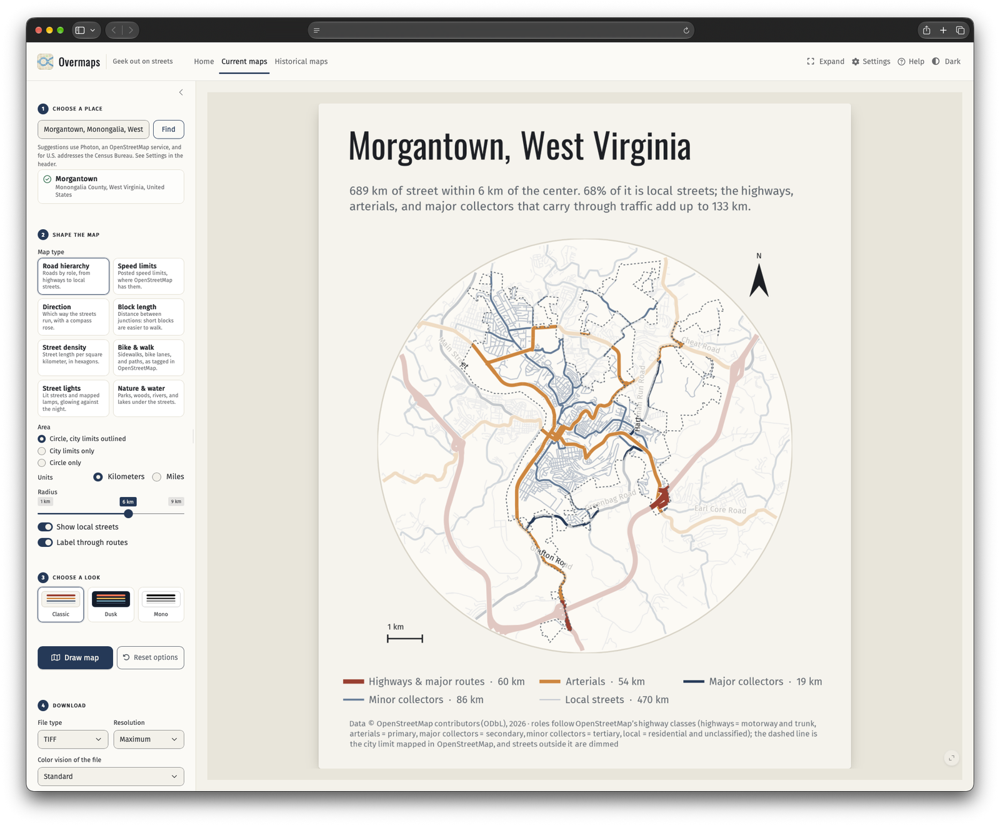
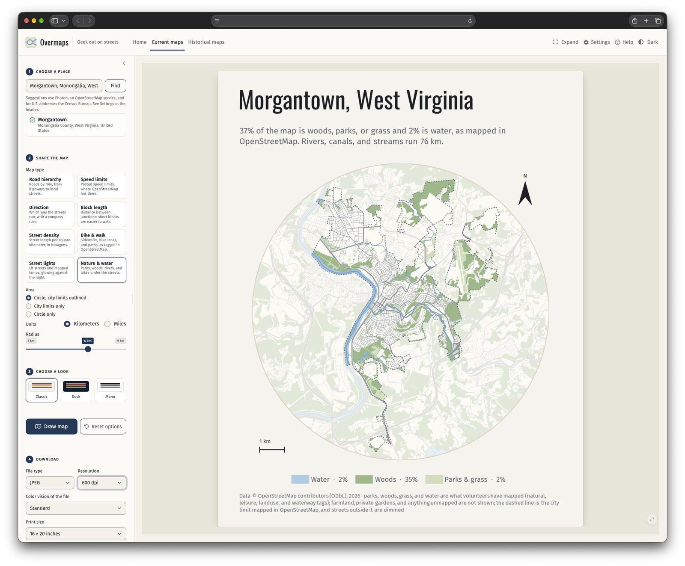
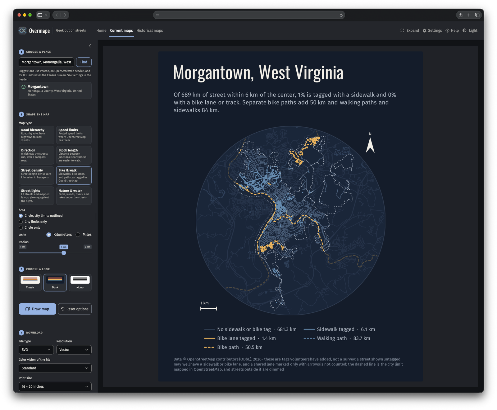
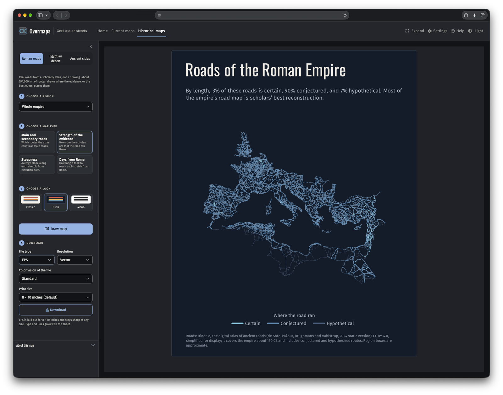
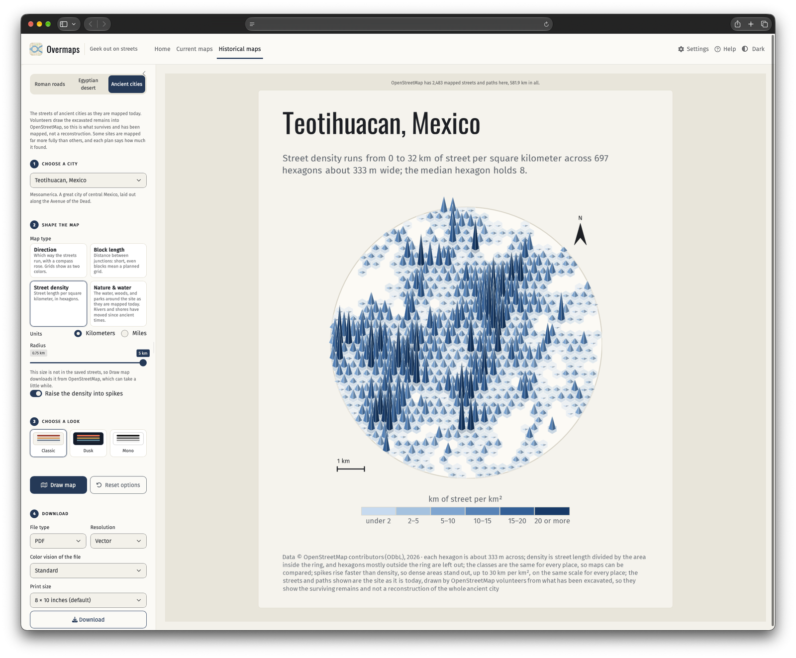

# Overmaps

Geek out on streets.

[](LICENSE.md)
[](https://shiny.posit.co/)
[](https://github.com/drabhikroy/overmaps/releases/latest)

Overmaps turns the street network of any place into a poster-quality map. Type an address, a city, or a landmark, choose what you want to see, and download a print-ready file. The maps cover the road hierarchy, posted speed limits, which way the streets run, block length, street density, bike and walk paths, street lights, nature and water, and, for places in the United States, population and housing from the 2020 Census. A second page, Historical maps, does the same kind of work for the roads of the Roman Empire, the street plans of ninety ancient sites, and modeled caravan routes across the Egyptian desert.



## On this page

- [What it does](#what-it-does)
- [What it does not do](#what-it-does-not-do)
- [Requirements](#requirements)
- [Install](#install)
- [Using Overmaps](#using-overmaps)
- [Your data](#your-data)
- [Accessibility](#accessibility)
- [How it works](#how-it-works)
- [For developers](#for-developers)
- [Contributing](#contributing)
- [Releases](#releases)
- [Citing](#citing)
- [License](#license)

## What it does

Overmaps has two map pages, Current maps for any place today and Historical maps for the ancient world. Both share one layout, with the choices in a sidebar on the left and the finished map on the right.

### Current maps

Search by address, city, or landmark. Address suggestions appear as you type, including house numbers. For U.S. addresses the U.S. Census Bureau address file is asked as well, so a home address can be found even when OpenStreetMap does not list it.

| Map type | What it shows |
| --- | --- |
| Road hierarchy | Roads by role, from highways to local streets, with the length of each class. |
| Speed limits | Posted speed limits, where OpenStreetMap has them. |
| Direction | Which way the streets run, with a compass rose. |
| Block length | The distance between junctions. Short blocks are easier to walk. |
| Street density | Street length per square kilometer, in hexagons. A switch raises each hexagon into a spike, so dense cores stand up from the flat map. |
| Bike & walk | Sidewalks, bike lanes, and paths, as tagged in OpenStreetMap. |
| Street lights | Lit streets and mapped street lamps glowing against a night version of the chosen look. The map reports how much lighting is mapped, because OpenStreetMap volunteers tag lighting unevenly from place to place. |
| Nature & water | Parks, woods, grass, lakes, rivers, and the sea, drawn softly under the streets, with the share of the map each one covers. |
| Population | U.S. only. Census block groups shaded by residents per square kilometer (or square mile) from the 2020 Census, with the streets drawn over them. The classes are fixed, so two places compare fairly, and the total is an estimate because a block group at the edge counts only for the part inside the map. |
| Housing | U.S. only. The same block groups shaded by housing units per square kilometer (or square mile). Outside the United States, or if the Census service does not answer, both maps draw the streets alone and say so. |

- **Circle, city limits, or both.** The radius starts just past the city limits, around the middle of the city. Choose a radius from 1 to 5 kilometers (or miles), outline the city limits, or map the city limits alone.
- **Compare places.** Put places side by side, including well-known planned street grids.
- **Share a map.** A link redraws the same map for another person.

### Looks and page theme

Every map can be redrawn in any of three looks without downloading the streets again. Classic is the default, Dusk is a dark, night-sky palette, and Mono is for black and white printing.

<p>
  
  
</p>

A button at the right end of the header switches the app between a light page and a dark page. The first visit follows the computer's setting, and the choice is kept in the browser. The page theme changes the app only. The look you picked still decides the map colors, and downloads never depend on the page theme. Below, Morgantown on the light page in Classic and on the dark page in Dusk.

<p>
  
  
</p>

### Historical maps

Historical maps is a page of its own, one tab away in the header. A picker at the top of the sidebar chooses between three sets, and each set names its sources under About this map.

#### Roman roads

The Itiner-e road network, shown by region and as main and secondary roads, strength of the evidence, steepness, or days of travel from Rome. Travel time can be on foot, by cart, or by courier, using the Hotham travel-time data. The map below colors each road by how strong the evidence is for it.



#### Ancient cities

Street plans of ninety ancient sites in 22 regions, drawn from excavated streets mapped in OpenStreetMap. Each plan starts at a radius fitted just past the mapped streets. The sites include the following.

| Group | Sites |
| --- | --- |
| Roman | Pompeii, Ostia Antica, Hadrian's Villa, Timgad, Volubilis, Dougga, Leptis Magna, Sabratha, Jerash, Baalbek |
| Greek and Roman | Ephesus, Cyrene, Paestum |
| Greek | Priene, Delos, Delphi, Olympia |
| Bronze Age Aegean and Anatolia | Mycenae, Knossos, Phaistos, Akrotiri, Troy, Hattusa |
| Mesopotamia and Iran | Babylon, Uruk, Ur, Persepolis, Pasargadae |
| Caravan cities | Petra, Palmyra, Merv |
| Egypt and Nubia | Giza, Amarna, Meroë |
| Southern Africa | Great Zimbabwe |
| Indus Valley | Six cities |
| South Asia | Nalanda, Hampi, Polonnaruwa, Sigiriya |
| Southeast Asia | Bagan, Sukhothai, Angkor Thom |
| Mesoamerica | Teotihuacan, Monte Albán, and six Maya cities |
| North America | Cahokia |
| The Andes | Caral, Chan Chan, Tiwanaku, and the Inca sites Ollantaytambo and Machu Picchu |
| Taş Tepeler | Göbekli Tepe and Karahan Tepe |

The Taş Tepeler sites are about 11,500 years old and predate streets, so their maps show only today's mapped paths and say so.

Where scholars have published a population estimate for a site, the note and the map caption give it as an estimate, not a count, with its period and source. Only five sites have one so far (Ostia Antica, Knossos, Teotihuacan, Angkor, and Great Zimbabwe), because a site is included only when a figure can be cited. The Angkor figure covers the whole Greater Angkor Region, not the walled city. The references are in [data/README.md](data/README.md).

Besides the street maps, every site has a Nature & water map, with the water, woods, and parks mapped around it today and a note that rivers and coasts have moved. A site also has a Street lights map where OpenStreetMap holds enough lamps or lit streets to draw one. Both show modern features, not ancient ones. Each map states how many streets OpenStreetMap holds for the site, because some sites are thinly mapped. A saved snapshot of the streets, water, and lamps can ship with the app, so the maps draw at once (see [data/README.md](data/README.md)).

<p>
  
  
</p>

#### Egyptian desert

Modeled camel caravan routes across the Eastern Desert in the Ptolemaic and Roman periods. They are 32,000 km of least-cost paths between 457 archaeological sites and watering places, colored by relative travel cost. These routes are computed, not found. A research model produced them, and every map and download says so, along with the authors' own check against travelers' routes. Data by Manière, Crépy and Redon (2020), CC BY 4.0.

### Downloads

Choose a file type (PNG, JPEG, TIFF, PDF, SVG, or EPS) and a resolution (150 dpi, 300 dpi, 600 dpi, or Maximum) side by side, at print sizes from 8 by 10 to 24 by 30 inches. PDF, SVG, and EPS are vector files, so their resolution menu offers only Vector. Very large sizes at high resolution are held to a file-size limit of about 45 million pixels. Maximum uses the most the size allows, and the page says when a size is capped. Every Download section also has a Color vision of the file menu, which starts at Standard.

### In the app

- **Expand.** The Expand button in the header gives the map the whole window on Current maps and on Historical maps. Esc or Exit expand goes back.
- **Settings.** The Settings page, at the right end of the header, holds the choices that apply to the whole app. These are the Color vision setting, the place-suggestion and remember-my-settings switches with their privacy notes, and the download counts.
- **Color vision.** The Color vision setting offers Standard, Deuteranopia, Protanopia, Tritanopia, and Grayscale. It recolors the buttons, tabs, and links of the app itself. On the maps, speed limits, direction, and nature and water get new colors for each kind of color blindness, and Grayscale turns every map into lightness steps. The palettes were checked under simulated color vision, and line weights and legends carry meaning too.
- **Help.** The Help tab answers common questions, lists every source and credit, and shows the version and license.

## What it does not do

- It does not draw a road network unless open, accurate data exists for it. No open road-line data exists for the Inca, Khmer, or Persian road networks, so those networks are not drawn.
- It does not reconstruct ancient cities. The Ancient cities maps show what survives and has been mapped today by OpenStreetMap volunteers, and some sites are mapped far more fully than others.
- It does not present the Egyptian desert routes as found roads. They are model results, and every map and download says so.
- It does not survey anything on the ground. Speed limits, sidewalks, bike lanes, and street lights show only what volunteers have tagged, so a street shown without a tag may still have one in real life.
- It does not give directions or show live traffic.

## Requirements

- R 4.1 or later
- An internet connection, because street data, place search, and fonts are fetched when needed
- A modern browser

## Install

1. Clone or download this repository.
2. Open a terminal in the project folder.
3. Run the installer, which adds any missing R packages to your personal library.

```sh
Rscript install.R
```

## Using Overmaps

1. Start the app from the terminal in the project folder.

   ```sh
   Rscript launch.R
   ```

   Overmaps opens in your browser on the Home page.
2. On Home, choose **Current maps** or **Historical maps**. Home, Current maps, Historical maps, Settings, and Help are tabs in the header, so switching is one click and each page keeps its settings.
3. On Current maps, type a place, choose a map type, and press **Draw map**.
4. Choose a look, then set the file type, resolution, and print size under Download.
5. On Historical maps, choose a set, choose a map type, and press **Draw map**.

### Other ways to start

To open Overmaps in its own window, without tabs or an address bar, add the popup option.

```sh
Rscript launch.R --popup
```

On a Mac you can also double-click `launch_overmaps.command` in Finder. From an R console, run the app directly.

```r
shiny::runApp(".", launch.browser = TRUE)
```

### Getting help

The Help tab inside the app lists the version and license. For bugs and questions, open an issue at <https://github.com/drabhikroy/overmaps/issues>.

## Your data

Overmaps has no accounts and no telemetry. Place text goes to the services that look it up, and nothing else leaves your computer. See [SECURITY.md](SECURITY.md) for the list of hosts and what each one receives. Saved settings, if you turn them on, stay in your browser and never include the address you typed.

## Accessibility

- **Page themes.** A light page and a dark page, switched by a button in the header. Every color vision option has its own dark variant that keeps text at a 4.5 to 1 contrast ratio or better.
- **Color vision.** Standard, Deuteranopia, Protanopia, Tritanopia, and Grayscale recolor the app and the maps. Each Download section has its own Color vision of the file menu.
- **Descriptions.** Map images carry text descriptions.
- **Targets and motion.** Page tabs, menus, and buttons are at least 44 pixels tall, and reduced-motion settings are respected.
- **Screen readers.** Status and error messages are announced. Toggles report their pressed state.
- **Keyboard.** Address suggestions form a labeled list that works with the keyboard, and focus is outlined on every control.

## How it works

- **Street data.** Street geometry comes from OpenStreetMap through the Overpass API, with several mirrors tried in turn.
- **Places.** Places are found with Nominatim, suggestions come from Photon, and U.S. house numbers can be matched against the Census Bureau geocoder.
- **Extra downloads.** The Bike & walk, Street lights, and Nature & water maps each ask for one more download, only when chosen. The Population and Housing maps ask the Census Bureau's TIGERweb service for the block groups around the map, and send only the map's bounding box.
- **Drawing.** Roads are classed by role, projected to a local UTM zone so distances are true, and drawn with ggplot2 and patchwork.
- **Bundled data.** The Roman roads come from the bundled Itiner-e data (see [data/README.md](data/README.md)).

## For developers

### Project layout

| Path | What it holds |
| --- | --- |
| `app.R` | The whole app, including the interface, the server, and the map drawing. |
| `install.R`, `launch.R`, `run_overmaps.R`, `launch_overmaps.command` | Package installation and the ways to start the app. |
| `check_servers.R` | A report of which OpenStreetMap servers your computer can reach, and how fast. |
| `data/` | The bundled map data. See [data/README.md](data/README.md). |
| `data-raw/` | The scripts that build the bundled data, and `check_site.R`, which diagnoses one ancient site. |
| `docs/` | The screenshots used in this file. |
| `icons/`, `www/` | The app icon sources and the web files the app serves. |
| `tests/` | The test suite and the browser scripts. |
| `.github/workflows/` | The test and release workflows. |

### Dependencies

The full list is in `DESCRIPTION`. The app uses shiny, bslib, sf, osmdata, dplyr, tidyr, purrr, tibble, stringr, ggplot2, ggtext, showtext, sysfonts, glue, patchwork, httr2, ragg, jsonlite, stringi, and rlang.

### Running from source

Open an R console in the project folder and run the app.

```r
shiny::runApp(".", launch.browser = TRUE)
```

### Tests

```sh
Rscript tests/run_tests.R
```

The suite runs against stubbed network calls, so it needs no internet connection. The `tests/browser` folder holds Playwright scripts that drive the offline demo app (`tests/demo_app.R`) in a real browser. Start them with `tests/with_app.sh`, for example the following.

```sh
tests/with_app.sh python3 tests/browser/browser_history_fullscreen_cities.py
```

## Contributing

Read [CONTRIBUTING.md](CONTRIBUTING.md) first, and open an issue before you write code. Everyone taking part is asked to follow the [code of conduct](CODE_OF_CONDUCT.md).

## Releases

Each release is listed at <https://github.com/drabhikroy/overmaps/releases>, with notes taken from [CHANGELOG.md](CHANGELOG.md).

## Citing

Overmaps includes a [CITATION.cff](CITATION.cff) file, so the repository page offers a Cite this repository option with ready-made citations.

## License

Overmaps is released under the [PolyForm Noncommercial License 1.0.0](LICENSE.md) (<https://polyformproject.org/licenses/noncommercial/1.0.0>). You may use, study, change, and share it for any noncommercial purpose. Commercial use needs separate permission.

Required notice: Copyright 2026 Abhik Roy.

### Data and artwork credits

- Map data: OpenStreetMap contributors (ODbL).
- Population and housing: U.S. Census Bureau, 2020 Census, through TIGERweb.
- Population estimates for ancient sites: the studies listed in [data/README.md](data/README.md).
- Roman roads: Itiner-e (CC BY 4.0).
- Travel times: Hotham (CC BY 4.0).
- Desert routes: Manière, Crépy and Redon, doi:10.5281/zenodo.4291876 (CC BY 4.0).
- Icons: the two pastel icons on the Home page are from the Noto Emoji set by Google (Apache License 2.0), found through [Iconify](https://iconify.design) and kept in `www/icons`. The faint street map behind Home is original artwork in `www/home-map.svg`.
