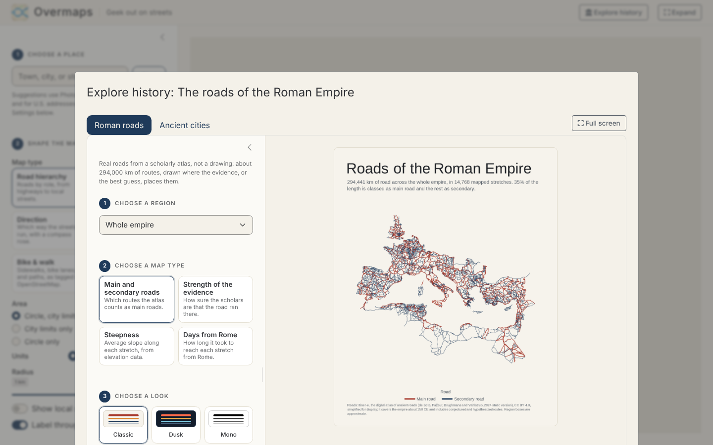

# Overmaps

Geek out on streets.

[](LICENSE.md)
[](https://shiny.posit.co/)
[](https://github.com/drabhikroy/overmaps/releases/latest)

Overmaps turns the street network of any place into a poster-quality map. Type an address, a city, or a landmark, pick what you want to see (the road hierarchy, posted speed limits, which way the streets run, how dense the network is, where people can walk and bike, or how long the blocks are), and download a print-ready file. A second window, Explore history, does the same for the roads of the Roman Empire and for the street plans of fifteen ancient cities.



## What it does

- **Maps any place.** Search by address, city, or landmark. Address suggestions appear as you type, including house numbers. For U.S. addresses the U.S. Census Bureau address file is asked as well, so a home address can be found even when OpenStreetMap does not list it.
- **Six map types.** Road hierarchy, speed limits, direction, street density, bike and walk, and block length.
- **Circle, city limits, or both.** Choose a radius from 1 to 5 kilometers (or miles), outline the city limits, or map the city limits alone.
- **Three looks.** Classic, Dusk, and Mono.
- **Print-ready downloads.** PNG, JPEG, TIFF (300 dpi), PDF, and SVG, at print sizes from 8 by 10 to 24 by 30 inches.
- **Compare places.** Put places side by side, including well-known planned street grids.
- **Share a map.** A link redraws the same map for another person.
- **Explore history: The roads of the Roman Empire.** The Itiner-e road network, shown by region, as main and secondary roads, strength of the evidence, steepness, or days of travel from Rome, on foot, by cart, or by courier, using the Hotham travel-time data. The window opens full screen with one click and keeps the same sidebar structure as the main page.
- **Ancient cities.** Street plans of Pompeii, Ostia Antica, Timgad, Leptis Magna, Ephesus, Priene, Delos, Knossos, Petra, Palmyra, Mohenjo-daro, Angkor Thom, Teotihuacan, Tikal, and Machu Picchu, drawn from excavated streets mapped in OpenStreetMap. They cover 11 civilizations: Roman, Greek and Roman, Greek, Minoan, Nabataean, Palmyrene, Indus Valley, Khmer, Teotihuacan, Maya, and Inca. Each map states how many streets OpenStreetMap holds for the site, because some sites are thinly mapped.

Only sites with open, accurate data are included. No open road-line data exists for the Inca, Khmer, or Persian road networks, so those networks are not drawn.

## Requirements

- R 4.1 or later
- An internet connection (street data, place search, and fonts are fetched when needed)
- A modern browser

## Install

Clone or download this repository, then open a terminal in the project folder.

```sh
Rscript install.R
```

The installer adds any missing R packages to your personal library.

## Using Overmaps

```sh
Rscript launch.R
```

This opens Overmaps in your browser. To open it in its own window, without tabs or an address bar:

```sh
Rscript launch.R --popup
```

On a Mac you can also double-click `launch_overmaps.command` in Finder.

You can run the app from an R console as well:

```r
shiny::runApp(".", launch.browser = TRUE)
```

Type a place, choose a map type, and press Draw map. Use **Explore history** in the header for the Roman roads and the ancient cities.

## Your data

Overmaps has no accounts and no telemetry. Place text goes to the services that look it up, and nothing else leaves your computer. See [SECURITY.md](SECURITY.md) for the list of hosts and what each one receives. Saved settings, if you turn them on, stay in your browser and never include the address you typed.

## Accessibility

- Map images carry text descriptions.
- Status and error messages are announced to screen readers.
- Address suggestions form a labeled list that works with the keyboard.
- Toggles report their pressed state.
- Focus is outlined on every control.

## How it works

Street geometry comes from OpenStreetMap through the Overpass API, with several mirrors tried in turn. Places are found with Nominatim, suggestions come from Photon, and U.S. house numbers can be matched against the Census Bureau geocoder. Roads are classed by role, projected to a local UTM zone so distances are true, and drawn with ggplot2 and patchwork. The Roman roads come from the bundled Itiner-e data (see [data/README.md](data/README.md)).

## Help

The **About** panel inside the app lists the version and license. For bugs and questions, open an issue at <https://github.com/drabhikroy/overmaps/issues>.

## For developers

### Dependencies

The full list is in `DESCRIPTION`. The app uses shiny, bslib, sf, osmdata, dplyr, tidyr, purrr, tibble, stringr, ggplot2, ggtext, showtext, sysfonts, glue, patchwork, httr2, ragg, jsonlite, stringi, and rlang.

### Tests

```sh
Rscript tests/run_tests.R
```

The suite runs against stubbed network calls, so it needs no internet connection. The `tests/browser` folder holds Playwright scripts that drive the offline demo app (`tests/demo_app.R`) in a real browser. Start them with `tests/with_app.sh`, for example:

```sh
tests/with_app.sh python3 tests/browser/browser_history_fullscreen_cities.py
```

## Contributing

Read [CONTRIBUTING.md](CONTRIBUTING.md) first, and open an issue before you write code.

## Releases

Each release is listed at <https://github.com/drabhikroy/overmaps/releases>, with notes taken from [CHANGELOG.md](CHANGELOG.md).

## License

Overmaps is released under the [PolyForm Noncommercial License 1.0.0](LICENSE.md) (<https://polyformproject.org/licenses/noncommercial/1.0.0>). You may use, study, change, and share it for any noncommercial purpose. Commercial use needs separate permission.

Required notice: Copyright 2026 Abhik Roy.

Map data: OpenStreetMap contributors (ODbL). Roman roads: Itiner-e (CC BY 4.0). Travel times: Hotham (CC BY 4.0).
