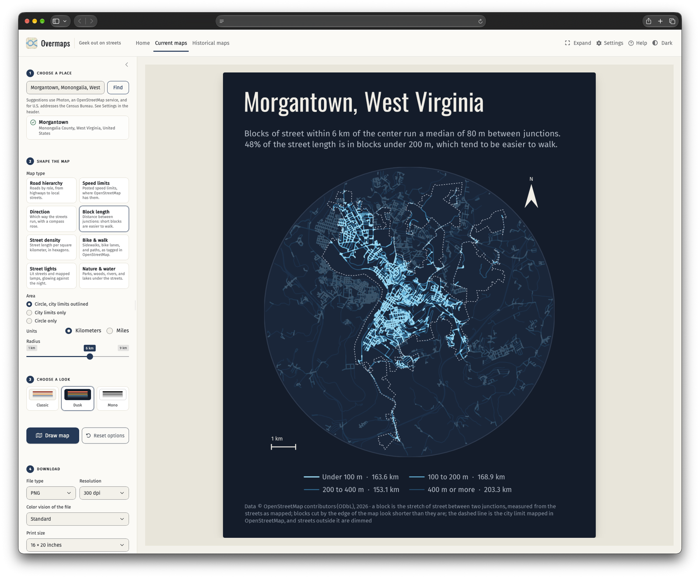
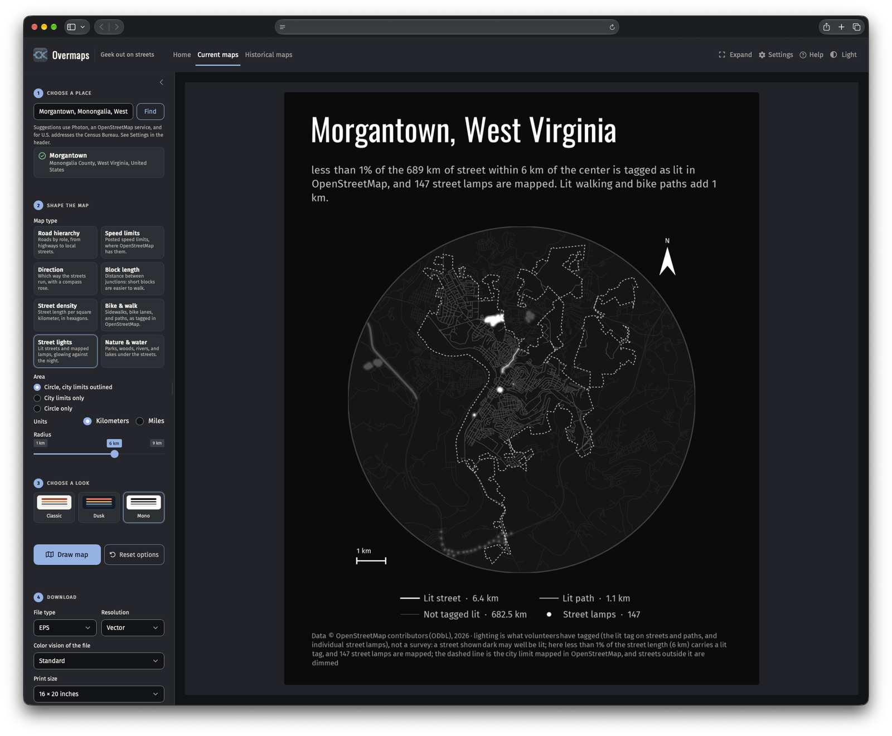
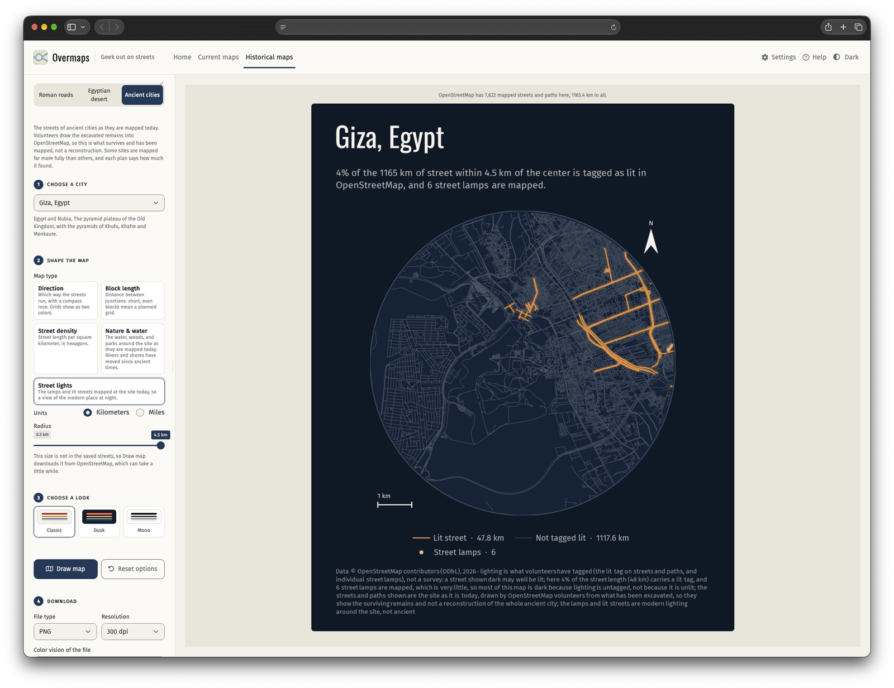

# Overmaps

Geek out on streets.

[](LICENSE.md)
[](https://shiny.posit.co/)
[](https://github.com/drabhikroy/overmaps/releases/latest)

Overmaps turns the street network of any place into a poster-quality map. Type an address, a city, or a landmark, pick what you want to see (the road hierarchy, posted speed limits, which way the streets run, how dense the network is, where people can walk and bike, or how long the blocks are), and download a print-ready file. A second window, Explore history, does the same for the roads of the Roman Empire and for the street plans of twenty-two ancient sites.


## What it does

- **Maps any place.** Search by address, city, or landmark. Address suggestions appear as you type, including house numbers. For U.S. addresses the U.S. Census Bureau address file is asked as well, so a home address can be found even when OpenStreetMap does not list it.
- **Eight map types.** Road hierarchy, speed limits, direction, block length, street density, bike and walk, street lights, and nature and water.
- **Street density as relief.** A switch on the street density map raises each hexagon into a spike, so dense cores stand up from the flat map.
- **Nature and water.** Parks, woods, grass, lakes, rivers, and the sea drawn softly under the streets in Classic, Dusk, or Mono, with the share of the map each covers.
- **Street lights.** Lit streets and mapped street lamps glow against a night version of whichever look is chosen. The map reports how much lighting is mapped, because OpenStreetMap volunteers tag lighting unevenly from place to place.
- **Circle, city limits, or both.** The radius starts just past the city limits, around the middle of the city. Choose a radius from 1 to 5 kilometers (or miles), outline the city limits, or map the city limits alone.
- **Help inside the app.** A Help tab answers common questions, lists every source and credit, and shows the version and license.
- **Three looks.** Classic, Dusk, and Mono, shown below.
- **Settings page.** Settings, at the right end of the header, holds the choices that apply to the whole app: the Color vision setting, the place-suggestion and remember-my-settings switches (with the privacy notes), and the download counts. The header reads Home, Current maps, and Historical maps on the left, and Expand (on the two map pages), Settings, Help, and the Light or Dark button on the right.
- **Light and dark page.** A button at the right end of the header switches the app between a light and a dark page. The first visit follows the computer's setting, and the choice is kept in the browser. It changes the app only: the Classic, Dusk, and Mono looks still decide the map colors, and downloads never depend on the page theme.
- **Color vision options.** The Color vision setting in Settings offers Standard, Deuteranopia, Protanopia, Tritanopia, and Grayscale. It recolors the buttons, tabs, and links of the app itself. On the maps, speed limits, direction, and nature and water get new colors for each kind of color blindness, and Grayscale turns every map into lightness steps. The palettes were checked under simulated color vision, and line weights and legends carry meaning too.
- **Print-ready downloads.** Choose a file type (PNG, JPEG, TIFF, PDF, SVG or EPS) and a resolution (150 dpi, 300 dpi, 600 dpi or Maximum) side by side, at print sizes from 8 by 10 to 24 by 30 inches. PDF, SVG and EPS are vector, so their resolution menu offers only Vector. Very large sizes at high resolution are held to a file-size limit (about 45 million pixels); Maximum uses the most the size allows, and the page says when a size is capped.
- **Expand on both map pages.** The Expand button in the header gives the map the whole window on Current maps and on Historical maps, and Esc or Exit expand goes back. The Historical maps tabs share these download options with the main map, and the Ancient cities tab also has the main map's units, radius and reset controls.
- **Compare places.** Put places side by side, including well-known planned street grids.
- **Share a map.** A link redraws the same map for another person.
- **Historical maps: The roads of the Roman Empire.** The Itiner-e road network, shown by region, as main and secondary roads, strength of the evidence, steepness, or days of travel from Rome, on foot, by cart, or by courier, using the Hotham travel-time data. The window opens full screen with one click and keeps the same sidebar structure as the main page.
- **Ancient cities.** Street plans of ninety ancient sites in 22 regions, each starting at a radius fitted just past the mapped streets, drawn from excavated streets mapped in OpenStreetMap: Roman (Pompeii, Ostia Antica, Hadrian's Villa, Timgad, Volubilis, Dougga, Leptis Magna, Sabratha, Jerash, Baalbek), Greek and Roman (Ephesus, Cyrene, Paestum), Greek (Priene, Delos, Delphi, Olympia), the Bronze Age Aegean (Mycenae, Knossos, Phaistos, Akrotiri) and Anatolia (Troy, Hattusa), Mesopotamia and Iran (Babylon, Uruk, Ur, Persepolis, Pasargadae), caravan cities (Petra, Palmyra, Merv), Egypt and Nubia (Giza, Amarna, Meroë), Great Zimbabwe, six Indus Valley cities, South Asia (Nalanda, Hampi, Polonnaruwa, Sigiriya), Southeast Asia (Bagan, Sukhothai, Angkor Thom), Mesoamerica (Teotihuacan, Monte Albán), six Maya cities, Cahokia, the Andes (Caral, Chan Chan, Tiwanaku), the Inca (Ollantaytambo, Machu Picchu), and the Taş Tepeler sites Göbekli Tepe and Karahan Tepe. The Taş Tepeler sites are about 11,500 years old and predate streets, so their maps show only today's mapped paths and say so. Besides the street maps, every site has a Nature & water map (the water, woods and parks mapped around it today, with a note that rivers and coasts have moved), and a Street lights map where OpenStreetMap holds enough lamps or lit streets to draw one; both show modern features, not ancient ones. Each map states how many streets OpenStreetMap holds for the site, because some sites are thinly mapped. A saved snapshot of the streets, water and lamps can ship with the app, so the maps draw at once (see [data/README.md](data/README.md)).
- **Egyptian desert.** Modeled camel caravan routes across the Eastern Desert in the Ptolemaic and Roman periods, 32,000 km of least-cost paths between 457 archaeological sites and watering places, colored by relative travel cost. These are computed, not found: a research model produced them, and every map and download says so, along with the authors' own check against travelers' routes. Data: Manière, Crépy and Redon (2020), CC BY 4.0.

Only sites with open, accurate data are included. No open road-line data exists for the Inca, Khmer, or Persian road networks, so those networks are not drawn.

### Three looks

Every map can be redrawn in any look without downloading the streets again. Classic is the default, Dusk is a dark, night-sky palette, and Mono is for black and white printing.

<p>
  
  
</p>

### Light and dark page

A button at the right end of the header switches the app between a light and a dark page. It changes the app only, so the look you picked for the map stays as it is: here Morgantown on the light page in Classic, and on the dark page in Dusk.

<p>
  
  
</p>

### Historical maps

Historical maps is a page of its own, one tab away in the header. Its Roman roads tab shows the Itiner-e network by region and by map type, here colored by how strong the evidence is for each road. The Ancient cities tab draws the streets of excavated sites as they are mapped today, such as Teotihuacan.

<p>
  
  
  
</p>

## Requirements

- R 4.1 or later
- An internet connection (street data, place search, and fonts are fetched when needed)
- A modern browser

## Install

Clone or download this repository, then open a terminal in the project folder.

```sh
Rscript install.R
```

The installer adds any missing R packages to your personal library.

## Using Overmaps

```sh
Rscript launch.R
```

This opens Overmaps in your browser. To open it in its own window, without tabs or an address bar:

```sh
Rscript launch.R --popup
```

On a Mac you can also double-click `launch_overmaps.command` in Finder.

You can run the app from an R console as well:

```r
shiny::runApp(".", launch.browser = TRUE)
```

Type a place, choose a map type, and press Draw map. The app opens on a **Home** page with a card for **Current maps** and one for **Historical maps** (the Roman roads, the ancient cities, and the modeled desert routes). Home, Current maps, Historical maps, and Help are tabs in the header, and each map set names its sources under About this map. The **Color vision** menu in the header recolors the whole app and every map for deuteranopia, protanopia, tritanopia, or grayscale.

## Your data

Overmaps has no accounts and no telemetry. Place text goes to the services that look it up, and nothing else leaves your computer. See [SECURITY.md](SECURITY.md) for the list of hosts and what each one receives. Saved settings, if you turn them on, stay in your browser and never include the address you typed.

## Accessibility

- Map images carry text descriptions.
- The Color vision setting in Settings recolors the app and the maps for deuteranopia, protanopia, tritanopia, and grayscale. Each Download section has its own Color vision of the file menu, which starts at Standard.
- The page tabs, menus, and buttons are at least 44 pixels tall, and reduced-motion settings are respected.
- Status and error messages are announced to screen readers.
- Address suggestions form a labeled list that works with the keyboard.
- Toggles report their pressed state.
- Focus is outlined on every control.

## How it works

Street geometry comes from OpenStreetMap through the Overpass API, with several mirrors tried in turn. Places are found with Nominatim, suggestions come from Photon, and U.S. house numbers can be matched against the Census Bureau geocoder. The Bike & walk, Street lights, and Nature & water maps each ask for one more download, only when chosen. Roads are classed by role, projected to a local UTM zone so distances are true, and drawn with ggplot2 and patchwork. The Roman roads come from the bundled Itiner-e data (see [data/README.md](data/README.md)).

## Help

The **About** panel inside the app lists the version and license. For bugs and questions, open an issue at <https://github.com/drabhikroy/overmaps/issues>.

## For developers

### Dependencies

The full list is in `DESCRIPTION`. The app uses shiny, bslib, sf, osmdata, dplyr, tidyr, purrr, tibble, stringr, ggplot2, ggtext, showtext, sysfonts, glue, patchwork, httr2, ragg, jsonlite, stringi, and rlang.

### Tests

```sh
Rscript tests/run_tests.R
```

The suite runs against stubbed network calls, so it needs no internet connection. The `tests/browser` folder holds Playwright scripts that drive the offline demo app (`tests/demo_app.R`) in a real browser. Start them with `tests/with_app.sh`, for example:

```sh
tests/with_app.sh python3 tests/browser/browser_history_fullscreen_cities.py
```

## Contributing

Read [CONTRIBUTING.md](CONTRIBUTING.md) first, and open an issue before you write code.

## Releases

Each release is listed at <https://github.com/drabhikroy/overmaps/releases>, with notes taken from [CHANGELOG.md](CHANGELOG.md).

## License

Overmaps is released under the [PolyForm Noncommercial License 1.0.0](LICENSE.md) (<https://polyformproject.org/licenses/noncommercial/1.0.0>). You may use, study, change, and share it for any noncommercial purpose. Commercial use needs separate permission.

Required notice: Copyright 2026 Abhik Roy.

Map data: OpenStreetMap contributors (ODbL). Roman roads: Itiner-e (CC BY 4.0). Travel times: Hotham (CC BY 4.0). Desert routes: Manière, Crépy and Redon, doi:10.5281/zenodo.4291876 (CC BY 4.0).

## Credits for bundled artwork

The two pastel icons on the Home page are from the Noto Emoji set by Google (Apache License 2.0), found through [Iconify](https://iconify.design) and kept in `www/icons`. The faint street map behind Home is original artwork in `www/home-map.svg`.
